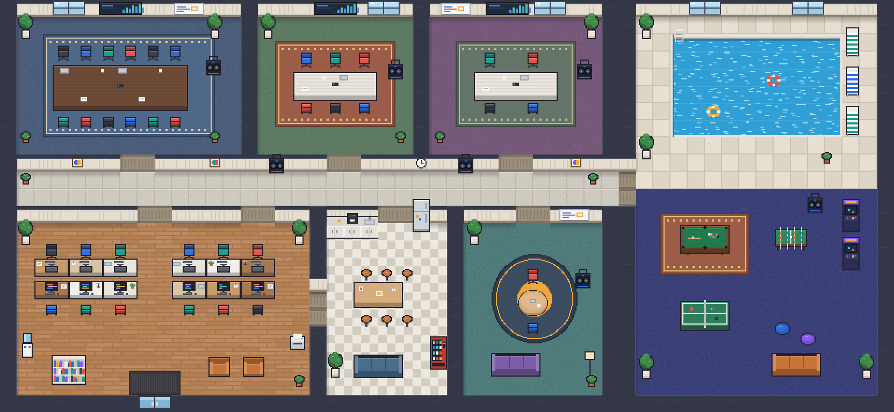

# Frédy · Escritório virtual

Escritório 2D em pixel art onde a equipe anda, se esbarra e conversa por **voz e vídeo por proximidade**. Para reunião, é só clicar numa cadeira: a call abre em tela cheia, com câmeras grandes, compartilhamento de tela e som isolado da sala.



**Stack:** Next.js 16 (App Router) · React 19 · TypeScript · Tailwind CSS 4 · Phaser 3 · Supabase (Auth, Postgres com RLS, Storage) · Ably (tempo real) · LiveKit (WebRTC) · Vercel

---

## Funcionalidades

**Mapa e movimento**
- Mapa top-down com área de trabalho, quatro salas de reunião (12, 6, 4 e 2 lugares), copa, corredor e área de lazer com piscina e salão de jogos.
- WASD/setas, colisão com paredes e móveis, zoom, e `Ctrl + arrastar` para mover o mapa.
- **Celular:** joystick, pinça para zoom, dois dedos para mover o mapa, barra compacta com menu "Mais" e instalação na tela inicial (PWA).
- Clique em objetos: sentar em sofás, banquetas e pufes; abrir a geladeira, pegar café ou lanche.
- Jogos de verdade nas mesas: pingue-pongue e totó para 2 pessoas em tempo real (ou contra o computador), **sinuca 8 ball** para 2 pessoas (lisas × listradas, faltas, bola na mão, puxar o taco para dar força e linhas de mira da branca e da bola atingida) e fliperama com recorde.
- Piscina: dá para nadar e pular da borda (barra de espaço).
- Mesa fixa: cada pessoa escolhe a sua e passa a começar o dia sentada nela.

**Áudio e vídeo**
- Proximidade com raio configurável (modos *fade* e *cutoff*); paredes das salas isolam o som.
- Reuniões em salas LiveKit separadas, com capacidade e acesso validados no servidor.
- Tela de reunião no estilo Meet: grade de câmeras em 720p, tela compartilhada em 1080p até 30 quadros/s (H.264) em destaque, modo ampliado, fixar participante, trocar de sala, minimizar para ver o mapa e **janela flutuante** (Picture-in-Picture) visível em outras abas.
- **Quadro branco** na reunião: todos da sala desenham juntos, com cores, borracha, desfazer, limpar e baixar a imagem. Quem chega recebe o que já foi desenhado.
- Sala trancada: quem chega **bate na porta** e alguém de dentro abre.
- Fundo da câmera: desfoque, imagens prontas ou imagem própria.
- Caixa de som por sala: cole um link do YouTube e todos da reunião ouvem em sincronia, com fila e repetição.
- Caixas de som também no corredor e na área de lazer: só quem está na área ouve.

**Agenda das salas**
- Reserve uma sala com nome, dia, horário, duração e convidados; horários que se sobrepõem são bloqueados.
- Os convidados recebem um aviso com som 5 minutos antes, com o botão "Entrar".
- A sala mostra "Reservada" no mapa e na reunião, e cada reserva tem o atalho "Adicionar ao Google Agenda".

**Convivência**
- Status (Disponível, Ocupado, Almoçando, Ausente, Não perturbe).
- Chamar alguém (toque + atalho para ir até a pessoa), reações com emoji, levantar a mão e um soco de brincadeira 👊 (tecla `F`).
- Avisos com som quando alguém chega na sede ou entra na sua sala.
- Chat geral, por sala e privado, com histórico.

**Administração**
- Usuários, escritórios, salas (capacidade, privacidade, convidados) e membros.
- Painel de **uso e custos**: minutos de LiveKit por dia e por pessoa, mensagens e picos do Ably.

---

## Arquitetura

```
Navegador ──HTTPS──► Next.js (Vercel)
   │                   ├─ páginas e Server Actions
   │                   ├─ /api/ably/token      token Ably com permissões mínimas
   │                   ├─ /api/livekit/token   token LiveKit (acesso, capacidade, sala trancada)
   │                   ├─ /api/messages        chat: valida, grava e publica
   │                   ├─ /api/music           caixa de som
   │                   ├─ /api/rooms/*         trancar sala e bater na porta
   │                   ├─ /api/bookings        agenda das salas
   │                   └─ /api/ring /desk /usage
   ├──WebSocket──► Ably      presença, movimento, chat, avisos
   ├──WebRTC─────► LiveKit   áudio, vídeo e tela
   └──HTTPS──────► Supabase  auth, banco (RLS), storage
```

Funções serverless não mantêm WebSocket aberto, então as conexões persistentes ficam no Ably e no LiveKit. O servidor só emite tokens de curta duração depois de validar o usuário.

- **Movimento:** a cena Phaser calcula o movimento com colisão e publica no máximo 10 atualizações por segundo, só quando muda. Os outros clientes interpolam. Posição não vai para o banco.
- **Proximidade:** todos entram na sala LiveKit de proximidade com `autoSubscribe: false`; a cada 200 ms o cliente calcula as distâncias e assina só quem está perto, com volume proporcional.
- **Reunião:** token apenas para a sala da reunião, depois de checar acesso, capacidade e tranca.

### Pastas

```
src/
  app/                 páginas, admin e rotas de API
  components/office/   interface do escritório (barra, reunião, chat, caixa de som...)
  lib/game/            mapa, colisão, proximidade, cena Phaser e arte gerada por código
  lib/realtime/        Ably (cliente e servidor)
  lib/media/           LiveKit e efeitos de fundo
supabase/migrations/   esquema, RLS e dados iniciais
tests/                 mapa, colisão, proximidade, agenda, quadro e validações
```

Toda a arte (personagens, pisos e móveis) é desenhada por código em `src/lib/game/art`.

---

## Banco de dados

Tabelas: `profiles`, `avatars`, `offices`, `office_members` (com mesa fixa), `rooms` (com caixa de som e tranca), `room_members`, `room_bookings`, `zone_music`, `messages`, `user_settings` e `media_usage`.

- RLS em todas as tabelas, com regras centralizadas em funções (`is_admin`, `is_office_member`, `can_access_room`...).
- O usuário não consegue alterar o próprio papel.
- Mensagens de sala privada e privadas só são lidas por quem participa.

---

## Rodando localmente

Requisitos: Node.js 20.9+ e contas no Supabase, Ably e LiveKit Cloud (todos têm plano gratuito).

```bash
npm install
cp .env.example .env.local   # preencha as variáveis
npm run dev                  # http://localhost:3000
```

| Variável | Onde | Para quê |
| --- | --- | --- |
| `NEXT_PUBLIC_SITE_URL` | público | URL do site |
| `NEXT_PUBLIC_SUPABASE_URL` | público | URL do projeto Supabase |
| `NEXT_PUBLIC_SUPABASE_PUBLISHABLE_KEY` | público | chave pública do Supabase |
| `SUPABASE_SECRET_KEY` | servidor | chave secreta do Supabase |
| `ABLY_API_KEY` | servidor | chave do app Ably |
| `LIVEKIT_URL` | servidor | `wss://seu-projeto.livekit.cloud` |
| `LIVEKIT_API_KEY` / `LIVEKIT_API_SECRET` | servidor | credenciais do LiveKit |

| Comando | Faz |
| --- | --- |
| `npm run dev` | desenvolvimento |
| `npm run build` / `npm start` | produção |
| `npm run check` | typecheck + lint + testes |

### Supabase

1. Crie um projeto e rode as migrations de `supabase/migrations/` em ordem (`npx supabase link` + `npx supabase db push`, ou pelo SQL Editor).
2. Em *Authentication → URL Configuration*, defina o Site URL e as Redirect URLs (`http://localhost:3000/**` e o domínio de produção).
3. Promova o primeiro administrador:

   ```sql
   update public.profiles set role = 'admin'
   where id = (select id from auth.users where email = 'voce@empresa.com');
   ```

### Deploy

Importe o repositório na Vercel, cadastre as variáveis acima e faça o deploy. Depois, atualize no Supabase o Site URL com o domínio final.

---

## Segurança

- Segredos só no servidor; o navegador recebe tokens temporários (Ably 1 h, LiveKit 15 min) presos ao usuário autenticado.
- Validação com zod em todas as rotas, RLS no banco e checagem de permissão repetida no servidor.
- Salas privadas e trancadas são validadas no servidor; o passe para entrar após "bater na porta" é assinado e expira em 2 minutos.
- Limites de frequência nas rotas, cabeçalhos de segurança e upload de foto restrito à pasta do próprio usuário.

## Limitações conhecidas

- Na área comum, a escolha de quem ouvir pela distância acontece no navegador. Reuniões não têm esse problema: são salas separadas, validadas no servidor.
- O limite de frequência é por instância serverless (em memória).
- O layout do mapa é definido em código (`src/lib/game/map.ts`).
